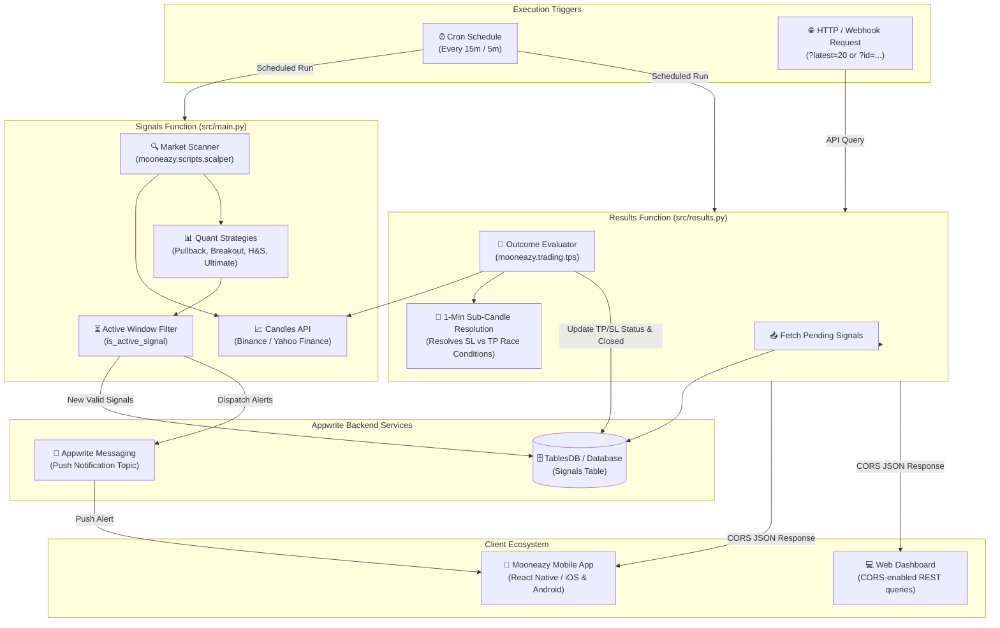
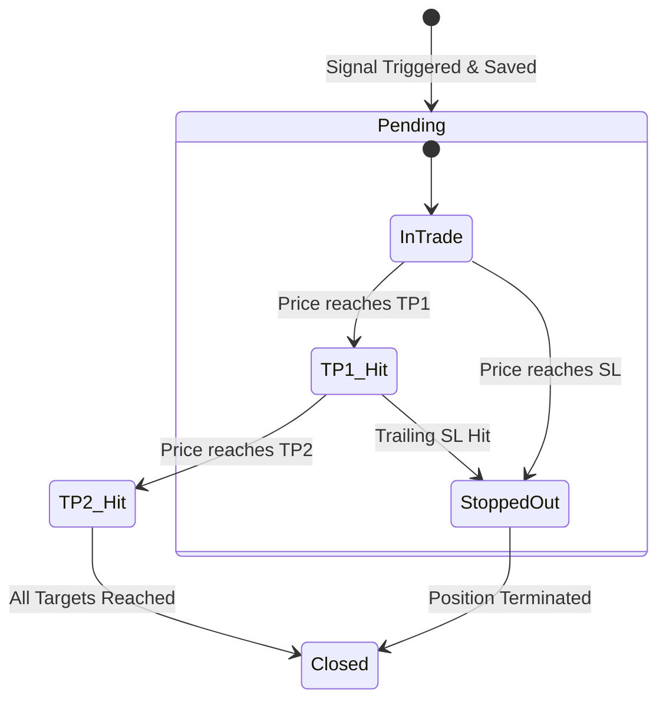

# 🌙 MOONEAZY SIGNALS

[](https://www.python.org/)
[](https://appwrite.io/)
[](https://docs.pydantic.dev/)
[](https://github.com/psf/black)

A library of trading algorithms that are part of **Mooneazy** trading ecosystem. Mooneazy is a trading signals application that scans the crypto and commodities market for high quality trading signals and alerts the trader when there is a viable trade setup. Mooneazy Signals is the signal generating and results tracking part of the project. The other part is Mooneazy Mobile wich is the main UI for Mooneazy. A trade signal consists of the symbol, interval, entry price, stop loss(sl), two take profit levels(tp1 and tp2) direction, and signal type. After a signal alert is generated, the system tracks the subsequent candles to check the results of the signal. The signal is successful if both take profit levels are reached before the stop loss is hit. If one take profit is hit the signal is partially successful and if neighther is hit the signal is failed. If neighther tp is hit and the sl is not hit either, the signal is in pending state. The library can be easily bundled into an executable file using Pyinstaller and targeting the src/mooneazy/mooneazy.py file or deployed as an Appwrite serveless function by targeting the src/main.py file.

---

> [!TIP]
> ### 📸 Visual Screenshot Placeholder 1: Mobile Push Alert in Action
> **Suggested Path:** `assets/screenshots/mobile_push_notification.png`  
> **What to capture:** A mobile device (iOS/Android) lock screen or banner notification displaying a live trade alert sent by Appwrite Messaging (e.g. `BTCUSDT Trade Alert - 15m pullback`).  
>
>   
> *Figure 1: Real-time trade alert delivered directly to subscribers via Appwrite Messaging.*

---

## 📑 Table of Contents

- [System Architecture](#-system-architecture)
- [Key Features](#-key-features)
- [Strategy Engine](#-strategy-engine)
- [Trade Lifecycle & Results Resolution](#-trade-lifecycle--results-resolution)
- [Appwrite Function Endpoints](#-appwrite-function-endpoints)
- [Database Schema & Data Models](#-database-schema--data-models)
- [Environment Variables & Configuration](#-environment-variables--configuration)
- [Local Development & Testing](#-local-development--testing)
- [Deployment Guide](#-deployment-guide)
- [Screenshot Placement Checklist](#-screenshot-placement-checklist)


## 🏗 System Architecture



---

> [!TIP]
> ### 📸 Visual Screenshot Placeholder 2: Trading Pattern & Strategy Setup
> **Suggested Path:** `assets/screenshots/trading_setup_chart.png`  
> **What to capture:** A candlestick chart (e.g. from TradingView or Binance) showing a valid trigger: EMA 8/20 cross, Hull Moving Average 55 filter, Breakout or Pullback level, Entry price line, Stop Loss, and TP1/TP2 targets.  
>
>   
> *Figure 2: Visual illustration of a trade setup with entry, stop loss, and target take-profit levels.*

---

## ✨ Key Features

1. **Multi-Strategy Engine**:
   - **Engulfing Breakout Strategy**: This is a strict breakout strategy that incorporated an engulfing breakout candle, momentum indicators (hull moving average(HMA 55), exponential moving average cross(EMA cross 8/20) and a high time frame trend or reversal considerations. An engulfing breakout candle, for the bullish scenario, is a candle that closes higher than the highest price within the previous five candles and touches the mid range of the previous five candles and at least 2 of the previous 5 candles must be bearish. This candle must also trigger a bullish cross of the 8/20 emas. To increase accuracy, the signal direction bust be in line with the higher time frame trend, usually the daily time frame. The inverse is true for the bearish case. 
   - **Pullback Strategy**: The pullback strategy scans for fake out trade signals(SFP & FA) when price touches the first pivot formed after largest impulse in market structure that meets the following conditions. The pivot has to retrace between fib 0.3 and 0.7. The subsequent swing after the pivot has to reach fib 0.5 of the pivot's own impulse. SFP, swing failure pattern, for the bullish case, is when price touches a level and the candle body does not close below the level and the subsequent candle becomes bullish. A failed auction (FA) is when a few candles usually less than 5 closes below a level and then the fullowing candle reverses and crosses back and closes above the level. 
   - **Head & Shoulders Strategy**: This is an ambitious heads and shoulders strategy that does not wait for the neck line to be crossed for a trade to qualify. Instead it waits for an SFP/FA signal at the left shoulder level  with the assumption that the right shoulder is forming. Since it is a reversal strategy and results in very many failed signals this iteration is only considered when it occurs on a very strong higher time frame support level. 
   - **Ultimate Setups**: This strategy scans for SFP/FA signals at strong pivot levels that matches higher time frame trends. Withing this strategy a pivot a minimum look back right and look back left of 30 candles each. These pivots are identified and watched for price SFP/FA reaction. Reactions that defy the higher time frame are ignored.

2. **Smart Active-Window Filtering**:
   - Triggers are strictly validated to ensure they are actionable. Trade alerts are sent within the next two candles. Once the third candlle is formed past the trigger candle the signal is considered stale.

3. **Multi-Timeframe Conflict Resolution (Sub-Candle Logic)**:
   - When both Stop-Loss and Take-Profit price levels are touched within the same higher-timeframe candle (e.g. 15m or 30m), the engine automatically fetches **1-minute candles** to accurately establish chronological priority: did the trade hit TP or SL first?

4. **Appwrite Cloud & Self-Hosted Native Integration**:
   - **Appwrite TablesDB**: Relational/table-based record keeping for all generated trades, state updates, and historic performance.
   - **Appwrite Messaging**: Automated push notification broadcast to subscriber topics (e.g. `mooneazy_signals`).

5. **CORS-Ready Client API**:
   - `src/results.py` includes built-in CORS headers and preflight `OPTIONS` handling, allowing direct invocation from local development environments (e.g. Expo / React Native on `localhost:8081`) and production web frontends.

6. **Local Developer Diagnostics**:
   - CLI debugger utilities (`src/mooneazy/mooneazy/scripts/scalper.py` and `src/testnet.py`) with optional audio buzzer notifications for local alert testing.

---

> [!TIP]
> ### 📸 Visual Screenshot Placeholder 3: Appwrite Functions Console
> **Suggested Path:** `assets/screenshots/appwrite_functions_dashboard.png`  
> **What to capture:** The Appwrite Console Functions view displaying the `signals` and `results` functions, active status, trigger schedules (Cron), and recent 200 OK execution times.  
>
>   
> *Figure 3: Appwrite Functions dashboard showing active deployments, cron schedules, and executions.*

---

## 🧠 Strategy Engine

The strategy layer lives in `src/mooneazy/mooneazy/` and provides modular quantitative signal detectors:

| Strategy | Primary Timeframes | Trend Filters | Target R:R (TP1 / TP2) | Pattern Characteristics |
|---|---|---|---|---|
| **Breakout** | `15m`, `30m` | HMA (55), EMA (8, 20) Cross | **1:2 / 1:5** | Engulfing candle breakout, ema (8, 20) cross, minimum score of 8, 2 opposite candles before break. |
| **Pullback** | `15m` | Higher Timeframe (4h) Trend | **1:2 / 1:5** | Swing pivot retracement into 0.382–0.70 Fibonacci zone with EMA 8/20 trend alignment. |
| **Head & Shoulders** | `30m` | Swing Pivots | **1:2 / 5:1** | Structural neckline and shoulder geometry with 0.8 Fibonacci resistance/support retest. |
| **Ultimate Setups** | `30m`, `4h` | Daily (1d) S/R & EMAs | **1:1.5 / 1:3** | Swing Failure Pattern (SFP), key liquidity pool fakeouts, and multi-timeframe level confirmation. |

### Supported Assets
- **Cryptocurrencies:** `BTCUSDT`, `ETHUSDT` (sourced via Binance API)
- **Precious Metals / Commodities:** `XAUUSDT` / `GC=F` (sourced via Yahoo Finance API)

---

## 🎯 Trade Lifecycle & Results Resolution

Signals generated by the engine follow a strict state progression:



### Sub-Candle Collision Algorithm (`mooneazy/trading/tps.py`)
In volatile market conditions, a single 15-minute or 30-minute candle may show:
$$\text{High} \ge \text{TP} \quad \text{and} \quad \text{Low} \le \text{SL}$$

Rather than guessing or misclassifying the result, the engine:
1. Detects the collision on the trade interval.
2. Automatically queries **1-minute (`1m`) candles** across the duration of the triggering period.
3. Steps sequentially through each 1-minute bar to evaluate which price boundary was breached first.
4. Correctly flags `tp1_status` / `tp2_status` as `success` or `failed`.

---

> [!TIP]
> ### 📸 Visual Screenshot Placeholder 4: Appwrite Database Signals Table
> **Suggested Path:** `assets/screenshots/appwrite_signals_table.png`  
> **What to capture:** The Appwrite Console `TablesDB` view showing records with columns: `symbol`, `interval`, `direction`, `entry_price`, `sl`, `tp1`, `tp2`, `tp1_status`, `tp2_status`, and `status`.  
>
>   
> *Figure 4: Stored signal rows with entry coordinates and lifecycle statuses in Appwrite TablesDB.*

---

## 🔌 Appwrite Function Endpoints

The repository contains two operational entrypoints designed for Appwrite Functions:

### 1. Signal Discovery & Alerts (`src/main.py`)
- **Trigger:** Scheduled Cron (e.g. `*/15 * * * *` at candle close) or manual HTTP trigger.
- **Workflow:**
  1. Calls `get_scalping_signals()` to fetch market candles and evaluate active strategies.
  2. Inserts newly discovered signals into the Appwrite `SignalsTable`.
  3. Formats and dispatches push notifications to the `mooneazy_signals` messaging topic.
- **Response Format:**
  ```json
  {
    "signals": [
      {
        "id": "67373f1a002b891e45c1",
        "symbol": "BTCUSDT",
        "interval": "15m",
        "time": 1731672000000,
        "utc_time": "2026-11-15 12:00:00",
        "direction": "buy",
        "signal_type": "pullback",
        "entry_price": 91250.0,
        "sl": 90400.0,
        "tp1": 92950.0,
        "tp2": 95500.0,
        "tp1_status": "pending",
        "tp2_status": "pending",
        "status": "pending"
      }
    ],
    "errors": null
  }
  ```

---

> [!TIP]
> ### 📸 Visual Screenshot Placeholder 5: Appwrite Messaging Delivery Logs
> **Suggested Path:** `assets/screenshots/appwrite_messaging_topics.png`  
> **What to capture:** Appwrite Console Messaging screen showing the `mooneazy_signals` topic, subscriber device tokens, and dispatch history with payload attributes.  
>
>   
> *Figure 5: Push notification delivery logs and subscriber topic configuration in Appwrite.*

---

### 2. Results & Performance Query API (`src/results.py`)
- **Trigger:** Scheduled Cron (e.g. `*/5 * * * *`) and frontend HTTP requests.
- **Features:** Full CORS support (`Access-Control-Allow-Origin: *`, preflight `OPTIONS` handling).
- **Query Parameters:**
  - `?latest=<count>`: Fetches the $N$ most recent signals sorted by `$createdAt DESC` without triggering outcome recalculations.
  - `?id=<signal_id>`: Evaluates a single target signal against current market prices.
  - *(no params)*: Fetches all currently `pending` signals in batch and resolves their outcomes.
- **Sample Request:**
  ```bash
  curl -X GET "https://your-appwrite-domain/v1/functions/<FUNCTION_ID>/executions?latest=10" \
       -H "x-appwrite-project: <PROJECT_ID>"
  ```

---

> [!TIP]
> ### 📸 Visual Screenshot Placeholder 6: Mooneazy Client App Feed
> **Suggested Path:** `assets/screenshots/mooneazy_app_signals_feed.png`  
> **What to capture:** The mobile app or web client screen rendering active trade cards, win/loss tags, entry prices, and take-profit targets consumed from the `/results` endpoint.  
>
>   
> *Figure 6: Client UI feed displaying active signals and closed performance cards.*

---

## 🗄 Database Schema & Data Models

Signals are validated using **Pydantic v2** (`src/appwrite_api/models.py`) before persistence in Appwrite TablesDB:

```
┌────────────────────────────────────────────────────────────────────────┐
│                              SignalModel                               │
├───────────────────┬───────────────────┬────────────────────────────────┤
│ Attribute         │ Type              │ Description                    │
├───────────────────┼───────────────────┼────────────────────────────────┤
│ id ($id)          │ string (UUID)     │ Unique document row identifier │
│ symbol            │ string            │ e.g. "BTCUSDT", "ETHUSDT"      │
│ interval          │ string            │ Execution timeframe ("15m")    │
│ time              │ integer           │ Candle epoch start time (ms)   │
│ utc_time          │ string            │ Human-readable UTC timestamp   │
│ direction         │ string            │ "buy" or "sell"                │
│ signal_type       │ string            │ "pullback", "breakout", etc.   │
│ entry_price       │ float             │ Target entry price level       │
│ sl                │ float             │ Stop-loss price level          │
│ tp1               │ float             │ First take-profit target       │
│ tp2               │ float             │ Second take-profit target      │
│ tp1_status        │ enum              │ "pending", "success", "failed" │
│ tp2_status        │ enum              │ "pending", "success", "failed" │
│ status            │ enum              │ "pending" or "closed"          │
└───────────────────┴───────────────────┴────────────────────────────────┘
```

---

## ⚙️ Environment Variables & Configuration

Set these variables in your Appwrite Function console or local `.env` file:

| Variable | Required | Description | Example / Recommended |
|---|---|---|---|
| `APPWRITE_FUNCTION_API_ENDPOINT` | **Yes** | Appwrite REST endpoint URL | `https://cloud.appwrite.io/v1` or `http://localhost/v1` |
| `APPWRITE_FUNCTION_PROJECT_ID` | **Yes** | Appwrite project identifier | `66d0c1...` |
| `APPWRITE_FUNCTION_API_KEY` | **Yes** | API key with Database `rows.read` and `rows.write` permissions | `standard_secret_key` |
| `PUSH_NOTIFICATIONS_API_KEYS` | **Yes** | API key with Messaging `messages.write` permissions | `messaging_secret_key` |
| `SIGNALS_DB_ID` | **Yes** | Database ID containing the signals table | `mooneazy_db` |
| `SIGNALS_TABLE_ID` | **Yes** | Table ID where signals are stored | `signals` |
| `FUNCTION_ENVIRONMENT` | No | Set to `dev` to send sample test alerts if no signals are triggered | `dev` / `production` |
| `ENVIRONMENT` | No | Set to `testing` to trigger local audio alerts via `betterplaysound` | `testing` / `production` |

---

## 🛠 Local Development & Testing

### Prerequisites
- Python 3.11+
- [`uv`](https://github.com/astral-sh/uv) (recommended) or standard `pip`

### 1. Setup Workspace
Clone the repository and install workspace dependencies:

```bash
# Using uv (fastest)
uv sync

# Or using standard pip & venv
python3.11 -m venv .venv
source .venv/bin/activate
pip install -r requirements.txt
```

### 2. Running Diagnostic Scripts
Run the scalper analysis directly from the command line:

```bash
# Run scalper debugger
python -m src.testnet
```

Or execute the scalper runner in a continuous loop:
```bash
python -m mooneazy.scripts.scalper
```

### 3. Running Test Suites
Run the pytest test suite:

```bash
# Run breakout strategy tests
pytest src/tests/breakouts_strategy/

# Run specific trading outcome tests
pytest src/tests/trading/test_results.py
```

---

## 🚀 Deployment Guide

### Deploying to Appwrite

1. **Create Appwrite Functions:**
   - In your Appwrite Console, navigate to **Functions** > **Create Function**.
   - Create two functions (or one multi-route function):
     1. **`signals-scanner`**: Scheduled market scanner.
     2. **`signals-results`**: Outcome evaluator & REST API.

2. **Function Configuration Settings:**

   | Setting | `signals-scanner` | `signals-results` |
   |---|---|---|
   | **Runtime** | Python 3.11 | Python 3.11 |
   | **Entrypoint** | `src/main.py` | `src/results.py` |
   | **Schedule (Cron)** | `*/15 * * * *` (every 15 min) | `*/5 * * * *` (every 5 min) |
   | **Timeout** | 120 seconds | 60 seconds |

3. **Install Dependencies in Appwrite:**
   Ensure your build command is configured as:
   ```bash
   pip install -r requirements.txt
   ```

4. **Verify Permissions & API Keys:**
   - Under Appwrite Console > **Overview** > **API Keys**, create keys granting:
     - `databases.read`, `databases.write` (or `tables.read`, `tables.write`)
     - `messages.read`, `messages.write`

---

## 📷 Screenshot Placement Checklist

Use this checklist as you take and add screenshots to complete the visual documentation:

- [ ] **Figure 1 (`assets/screenshots/mobile_push_notification.png`)**  
  *Lock screen or banner push notification on a phone showing a real-time signal.*
- [ ] **Figure 2 (`assets/screenshots/trading_setup_chart.png`)**  
  *Candlestick chart illustrating entry, stop-loss, and take-profit targets.*
- [ ] **Figure 3 (`assets/screenshots/appwrite_functions_dashboard.png`)**  
  *Appwrite Console Functions page showing active deployments and cron status.*
- [ ] **Figure 4 (`assets/screenshots/appwrite_signals_table.png`)**  
  *Appwrite TablesDB view displaying recorded trade signal rows.*
- [ ] **Figure 5 (`assets/screenshots/appwrite_messaging_topics.png`)**  
  *Appwrite Messaging Console showing topic subscriber configuration and delivery logs.*
- [ ] **Figure 6 (`assets/screenshots/mooneazy_app_signals_feed.png`)**  
  *Mooneazy frontend or mobile app rendering live signal cards.*

---

## 📄 License

Internal proprietary software developed for the **Mooneazy** platform. All rights reserved.
3. **Build Command:** `pip install -r requirements.txt`
4. **Schedule:** `*/15 * * * *` (recommended to run on candle close every 15 minutes)
